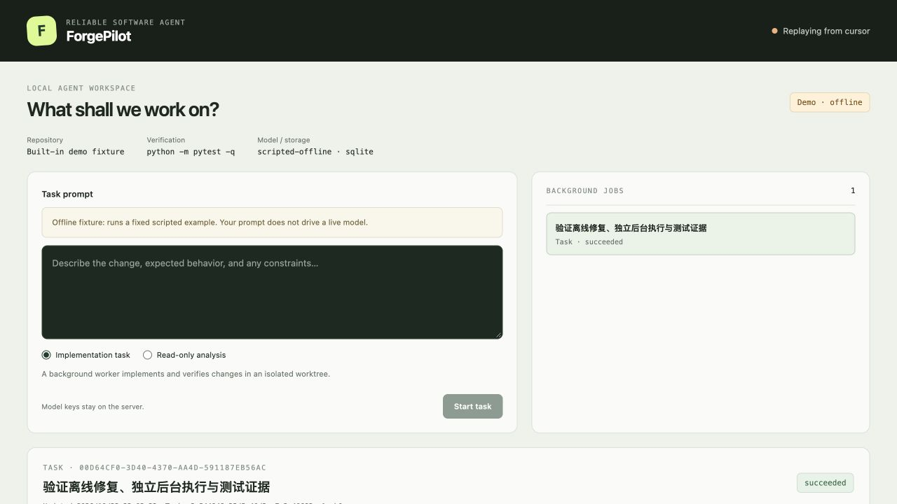

# ForgePilot

面向代码仓库修复的 Agent 工作台。接入真实模型 API，在独立 Git worktree 中分析代码、调用工具、修改补丁，再由宿主执行固定验收命令，生成补丁、测试报告、事件轨迹和 PR 草稿。

**React 工作台 + Textual TUI + 独立后台任务 + 只读分析子代理 + MySQL + MCP / Skills。**
从[快速开始](docs/QUICKSTART.md)进入 Demo，再按[真实模型 E2E](docs/LIVE_E2E.md)准备在线验收。MySQL 配置见[数据库说明](docs/MYSQL.md)。API Key 只留在本机服务进程环境，不进网页、TOML、任务描述或 Git。

原名 RepoPilot-R，现统一使用 ForgePilot；Python 模块 `repopilot` 与旧命令保留兼容。仓库地址仍为 `chen9zz/coding-assistant`。



*截图为离线 fixture 演示，不代表真实模型结果。真实 DeepSeek 验证单独记录如下。*

## 已实现的能力

| 能力 | 实现与边界 |
| --- | --- |
| 模型接入 | 原生 HTTP 适配 OpenAI-compatible / Anthropic 协议，可配置 endpoint 与模型；已完成真实 DeepSeek 调用验证 |
| 仓库上下文 | Tree-sitter 与 ripgrep，限制上下文体积；有界字节分页读取及独立二进制前缀检查 |
| MCP 与 Skills | MCP SDK 2，stdio / Streamable HTTP、工具白名单；按需读取 SKILL.md 及引用资料 |
| 后台执行 | 独立 worker、本地持久队列、恢复与取消；子代理仅做只读分析，不执行命令、不改文件、不递归派生 |
| 权限与验收 | Git worktree、路径/命令检查、精确审批、步数/时限预算；宿主独立复跑验收 |
| 持久化与回放 | MySQL / SQLite 保存任务、事件和操作结果，SQLite 保存后台队列；已提交结果可重放，结果不确定的副作用停止重试 |
| 交互与证据 | React / SSE 展示状态、审批与工件；Textual TUI 连接同一服务；仅生成 PR 草稿，不自动推送 |

## 验证结果

2026-10-23（Pacific/Auckland），Python 3.13.13 / macOS arm64：

| 范围 | 结果 |
| --- | --- |
| 发布前全量回归，启用真实 MySQL | 340 passed，1 项 SQLite 专属 skip |
| 综合覆盖率（语句与分支合计） | 87.95%，保留 85% 门槛 |
| 前端 | 11 项测试、TypeScript 检查及生产构建通过 |
| 真实模型仓库任务 | DeepSeek + MySQL 闭环 SUCCEEDED；32 项独立验收及 236 项候选仓库测试通过，宿主与后续独立复测均通过 |
| 离线评估 | 3/3 确定性 fixture 通过；不是模型能力榜单或 SWE-bench 成绩 |

真实任务经过**八轮调试、人工定位反馈和检查点续修**，不是一次零干预成功。236 项是历史候选仓库测试数，不与宿主测试数相加。简历所引用的前一轮宿主结果为 339 项通过、87.97%；本次发布新增一项公开 Git 历史兼容回归后为 340 项，覆盖率以当次完整执行统计为准。失败历史、验收版本与工件摘要见[真实验收报告](docs/LIVE_E2E_VERIFICATION.md)和[排错记录](docs/DEBUG_JOURNAL.md)。

历史结果保留在 [0.1 验证](docs/VERIFICATION_REPORT.md)、[0.2 验证](docs/CONNECTED_VERIFICATION.md)和 [0.3 初始验证](docs/FORGEPILOT_VERIFICATION.md)，不作为当前版本成绩。

## 架构

```text
Textual TUI / React 19 workbench / CLI
                    |
     Loopback control API / persistent jobs
                    |
  Background worker + read-only analysis children
                    |
          TaskApplicationService
                    |
        DurableTaskOrchestrator
     state machine + SQLite / MySQL event log
                    |
             MinimalAgentLoop
                    |
            SafeToolGateway
 policy -> durable claim -> tool -> redaction -> commit
                    |
 Git worktree / repo map / patch / tests / artifacts
```

核心后端使用 Python 3.12+、Pydantic 2、FastAPI、Textual、SQLite、SQLAlchemy/PyMySQL、Tree-sitter 和 ripgrep。前端使用 React 19、TypeScript、Vite 与 Vitest。原生 HTTP 适配 OpenAI-compatible / Anthropic 协议，支持 MCP 2 和 Skills 按需加载；离线核心不需要 API Key 或 Docker。MySQL 存任务/事件，进程队列仍是本地 SQLite，不宣称分布式调度。子代理仅分析，不拥有命令、修改、MCP 或递归派生能力。

## 五分钟运行

需要 Python 3.12+、Git、ripgrep 和 Node.js 24。首次运行：

```bash
git clone https://github.com/chen9zz/coding-assistant.git
cd coding-assistant
python3 -m venv .venv
.venv/bin/python -m pip install -e ".[dev]"
npm --prefix web ci
npm --prefix web run build
.venv/bin/forgepilot ui --demo --workspace /tmp/forgepilot-demo-001
```

打开 http://127.0.0.1:8765 即可提交离线 Demo；另开终端使用 TUI：

```bash
.venv/bin/forgepilot tui --url http://127.0.0.1:8765
```

Demo 是固定脚本，不会根据输入自由编程，不代表真实模型表现。在线使用需要显式 `--repo`、`--config` 和固定验收命令，详见快速开始。界面只绑定本机，有同源、Host 与请求 token 校验，不是公网多用户服务。

完整离线验证运行 `sh scripts/verify.sh`。已有 CLI `demo`、`run`、`resume` 和旧审计 API 仍兼容；日常界面优先使用新的 `ui` 入口。

默认测试未配置数据库时会跳过真实 MySQL 用例；按[数据库说明](docs/MYSQL.md)显式启用测试并安全注入凭据。`benchmarks/live-e2e-baseline.bundle` 是固定历史源码 fixture，用于复现缺失分页的基线，不是数据库或真实任务运行数据。

基线包保持原始提交身份，内部包含早期源码、测试和开发规划笔记；这些历史文本也经过发布审查。它不包含本轮真实模型调用的工作区、数据库或原始轨迹。

## 安全与使用限制

- Key 与数据库密码不进浏览器、源码、任务或 Git。模型调用可能向配置供应商发送仓库内容，使用前确认数据授权与费用。
- Git worktree、命令策略与环境过滤不是 OS 级恶意代码沙箱，仅用于个人可信仓库。Docker Compose 仅提供可选 MySQL 测试环境。
- 本机 Host、同源及控制 token 检查不是用户登录认证。云端认证与执行隔离仍属于[部署方案](docs/CLOUD_DEPLOYMENT_PLAN.md)，不是已上线能力。
- `.env`、私钥、密码文件、数据库、运行日志、任务工作区及本机构建目录不纳入版本控制。公开文档保留脱敏调试说明与验收摘要，不包含真实任务原始日志。

## 交付导航

- [真实 DeepSeek + MySQL 端到端验收（2026-10-23）](docs/LIVE_E2E_VERIFICATION.md)
- [本对话的问题与完整排错记录](docs/DEBUG_JOURNAL.md)
- [不依赖本机的云端部署方案与上线门槛](docs/CLOUD_DEPLOYMENT_PLAN.md)

- [真实模型 API、MCP、Skills 与能力边界](docs/CONNECTED_ASSISTANT.md)

- [项目说明与架构](docs/PROJECT_GUIDE.md)
- [重要代码逐行解析](docs/CODE_WALKTHROUGH.md)
- [项目简介与中英文简历写法](docs/PROJECT_BRIEF_AND_RESUME.md)
- [业务对接与落地路径](docs/BUSINESS_INTEGRATION.md)
- [安全边界与威胁模型](docs/SECURITY.md)
- [评估口径和可复现结果](docs/EVALUATION.md)
- [演示脚本](docs/DEMO.md)
- [技术调研来源](docs/SOURCES.md)
- [最终验证报告](docs/VERIFICATION_REPORT.md)

项目采用 MIT License 元数据。当前实现不会自动推送远程分支或创建真实 PR；它只生成可审核的 PR 草稿和证据包，把最终发布动作留给人或上层 CI。
